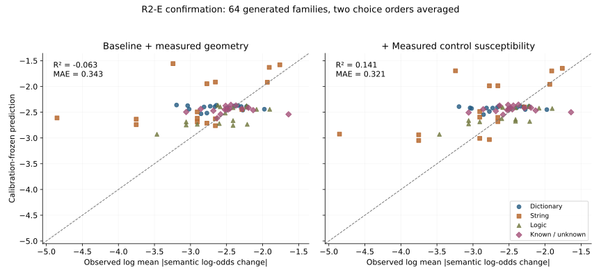
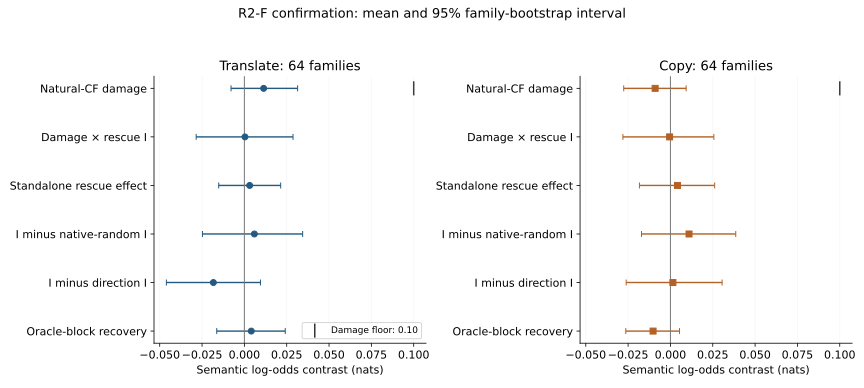
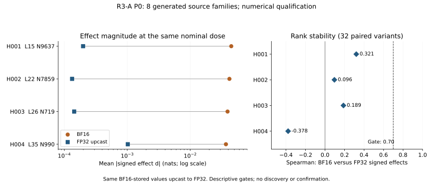
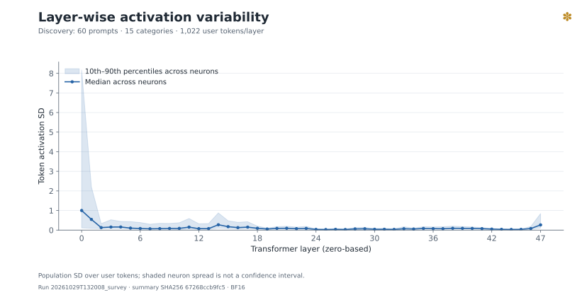
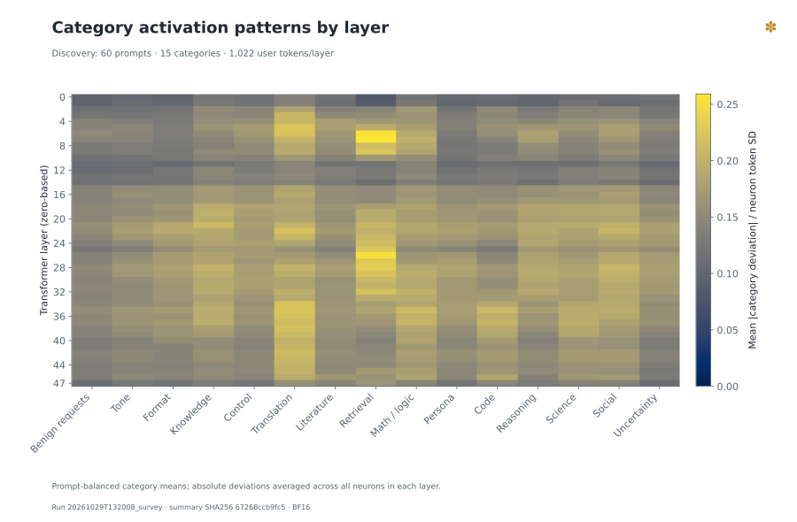
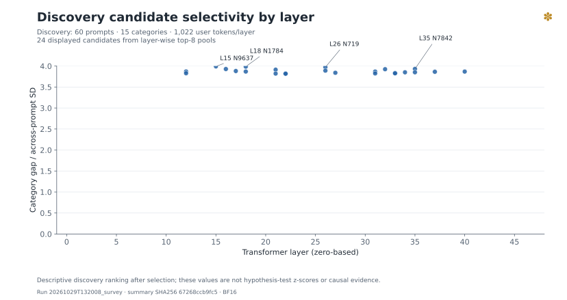
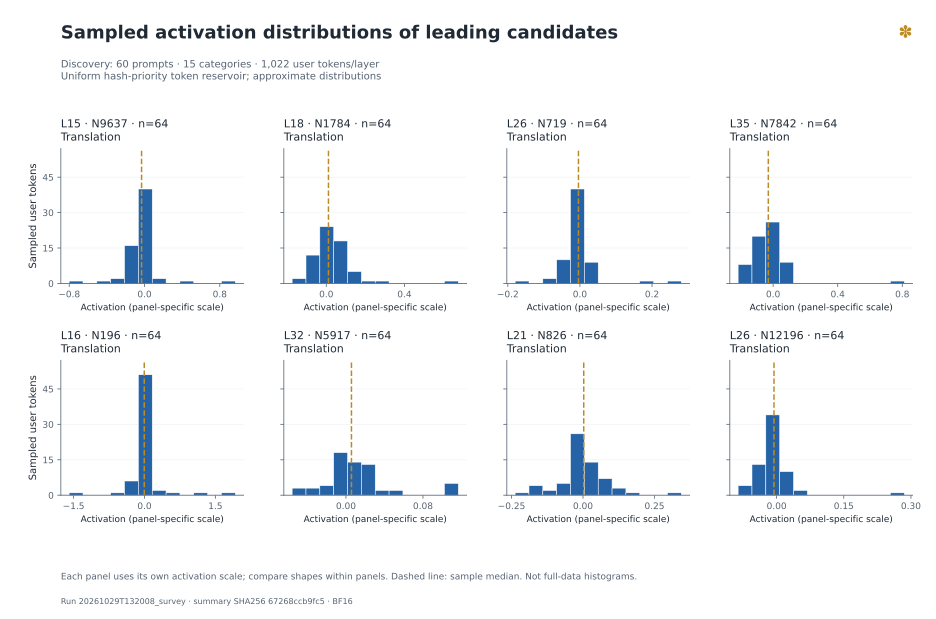
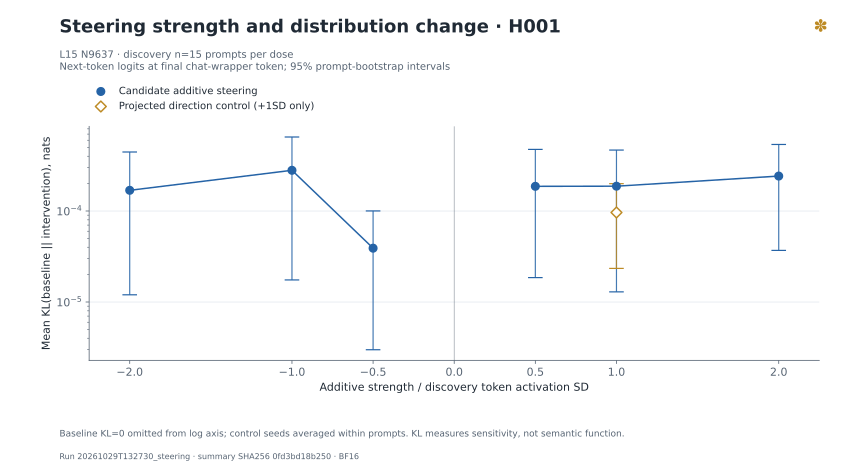
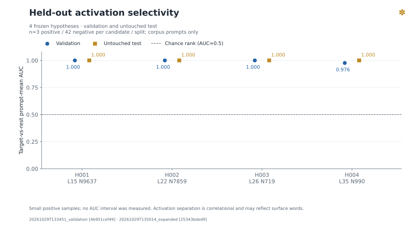
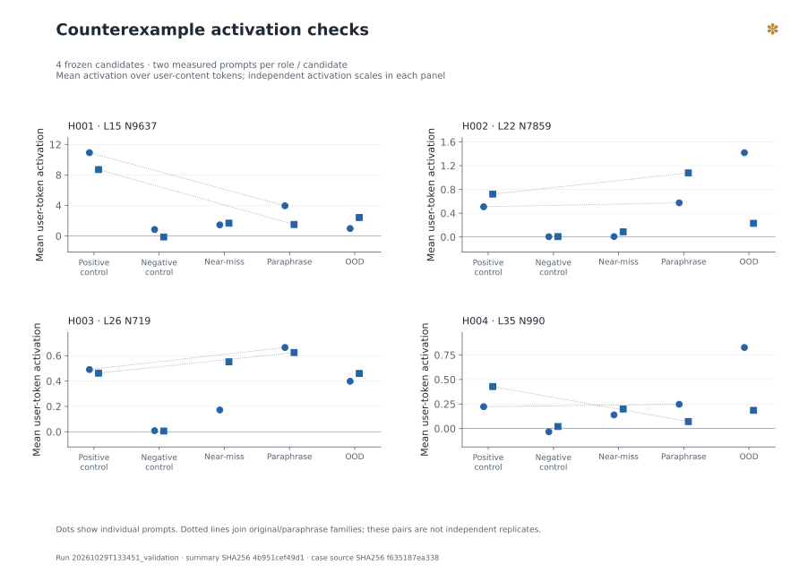

<!-- Generated from measured summary files by scripts/build_readme.py. -->
# Gemma 4 Neuron Lab

*Autonomous Discovery, Steering, and Causal Analysis of LLM Neurons*

## Project Overview

Gemma 4 12B의 MLP 뉴런을 BF16 활성값 수집, steering 개입, 무작위 대조군과 독립 검증으로 연구합니다. 뉴런은 `GELU(gate(x)) × up(x)` 이후, `down_proj` 이전의 중간 활성 좌표로 정의합니다. Python·PyTorch·Transformers, streaming 통계, SQLite·Parquet를 사용합니다. [연구 지침](MASTER.md)과 [방법론](docs/METHODOLOGY.md)에 재현 조건과 한계를 기록합니다.

## Research Status

기록 기준: **2026-10-29 KST**. 아래 `PASS`는 해당 실행·기술 검증 상태입니다. 뉴런 기능·인과성의 검증 상태는 카탈로그에서 별도로 표시합니다.

| 단계 | 실행·기록 상태 | 근거 |
|---|---|---|
| CP0 환경·저장소·참조 감사 | PASS | [기록](docs/REFERENCE_AUDIT.md) |
| CP1 BF16 모델·런타임 아키텍처 | PASS | [기록](logs/summary/model_load.json) |
| CP2 훅·Smoke Test | PASS | [기록](logs/summary/smoke.json) |
| CP3 활성 통계·시각화 | PASS · 전체 계층 | [기록](logs/summary/survey.json) |
| CP4 Steering·무작위 대조군 | PASS | [기록](logs/summary/steering.json) |
| CP5 독립 가설 검증 | PASS | [기록](logs/summary/validation.json) |
| CP6 확대 탐색·카탈로그 | PASS · 카탈로그 있음 | [기록](logs/summary/expanded.json) |
| CP7 반례·연구 후보 종합 | PASS | [기록](logs/summary/synthesis.json) |
| CP8 최종 기록·공개 정리 | 게시 확인 | [기록](reports/RESEARCH_SUMMARY_KO.md) |

## Round 2: 추천 5번·6번 실제 실행

새 연구로 **10,816개 조건 행**, 검증·보정을 포함해 **11,568회 실제 BF16 forward**를 수행했습니다. GPT Pro Deep research·Claude Opus 5.5 Extra Research의 설계 검토를 통합하고, calibration 파라미터를 commit한 뒤 별도 확증을 실행했습니다.

| 실험 | 확증 family | 1차 결과 | 연구 판정 |
|---|---:|---|---|
| 5 입력 취약도 예측 | 64 | ΔR² 0.2043 [0.08981, 0.2921] | 등록 범위 내 지지 |
| 6 H001→H003 복구 | 64 | 손상 0.01139 [-0.007882, 0.03145] nats; I=0.0003548 | 식별 불가 |

5번은 후보를 먼저 측정해 그 geometry로 대조의 크기를 정한 조건부 예측입니다. 후보 관측 전 예측이나 호출 절감은 입증하지 않았습니다. 6번은 손상 gate가 통과한 경우에만 복구 비율을 해석합니다. 괄호는 95% family bootstrap CI이며 실행 PASS와 가설 지지는 별개입니다. [실측 보고서](reports/ROUND2_EF_RESULTS_KO.md) · [등록 설계](docs/ROUND2_EF_PREREGISTRATION.md) · [요약 JSON](logs/summary/round2_ef_analysis.json)

결과 게시 확인: [aa1b92fc](https://github.com/PigeonLabs/Gemma4_neuron_LAB/commit/aa1b92fc45b1dd72e3410d303f50296c948c062f). [R2 게시 기록](logs/summary/round2_ef_publication.json)

실측 결과를 GPT Pro·Claude Opus 5.5 Extra에 전달해 재검토를 완료했습니다. Novelty 우선 후속 추천: 1위 내용·답변 토큰 편향과 규칙 수행 효과의 부호 분해 → 2위 후보 개입을 보기 전 고정 probe로 새 과제·뉴런 반응 예측. 이는 실행 전 추천 기록이며, 이후 1번의 실제 진행 상태는 아래 R3-A 결과를 따릅니다. [피드백 반영·설계 상세](reports/ROUND3_RECOMMENDATIONS_KO.md)



64개 생성 family에서 각 두 선택지 순서를 평균했습니다. 같은 축에서 고정된 기본·확장 예측식을 비교합니다.



각 mode의 64개 생성 family, 점은 평균·선은 95% family CI입니다. 세부 대조와 한계는 보고서에 기록했습니다.

## R3-A: 추천 1번의 실제 수치 검증

**사전등록한 수치 gate 미통과로 P0에서 중단했습니다.** 새 8 family의 32변형에서 576개 조건 행·699회 실제 forward를 측정했습니다. 같은 BF16 저장 가중치를 FP32로 올려 비교했으며 훅·복원·nonzero 개입 전달은 통과했습니다.

| 후보 | BF16 평균 절댓값 (nats) | FP32 평균 절댓값 (nats) | 부호 효과 Spearman | 수치 eligible |
|---|---:|---:|---:|---|
| H001 | 0.0448 | 0.0001987 | 0.3207 | 미통과 |
| H002 | 0.04187 | 0.000133 | 0.09633 | 미통과 |
| H003 | 0.03912 | 0.0001437 | 0.1888 | 미통과 |
| H004 | 0.03687 | 0.001019 | -0.3784 | 미통과 |

32변형은 8개 원본의 paired 파생이며 독립 n=32가 아닙니다. 현재 dose·위치·과제에서 정밀도에 안정적인 의미 효과를 확인하지 못했습니다. 뉴런의 기능 부재나 기존 R2 통계의 소급 무효화를 뜻하지 않습니다. Discovery·calibration·confirmation은 **NOT_EVALUATED**입니다.

[실측·중단 사유](reports/ROUND3A_RESULTS_KO.md) · [등록 기준](docs/ROUND3A_PREREGISTRATION.md) · [실측 JSON](logs/summary/round3a_p0.json)




## Key Findings

- BF16 실제 모델의 737,280개 MLP 좌표를 확인하고 smoke 28/28을 통과했다. Discovery 60개 입력의 사용자 본문 1,022토큰/계층을 집계했다. [측정 근거](logs/summary/model_load.json) · [측정 근거](logs/summary/smoke.json) · [측정 근거](logs/summary/survey.json)
- 동결한 후보 4개의 독립 test 활성 AUC는 모두 1.0이었다. 각 후보의 양성은 3개, 음성은 42개인 자체 작성 편의 표본이다. 의미 기능을 확정하는 결과는 아니다. [측정 근거](logs/summary/analysis.json)
- 네 후보 모두 validation/test에서 norm-matched 방향 대조군 대비 범주별 개입 효과 차이의 95% CI가 0을 포함했다. 등록한 선택적 분포 효과 기준은 지지되지 않았으며 카탈로그 상태는 모두 ambiguous다. [측정 근거](logs/summary/analysis.json) · [측정 근거](catalog/public/neurons.json)
- 별도 동결 utility 16문제(일반 8·번역 8), 실제 272회 생성에서 모든 ±1SD·zero·대조군 조건은 16/16 정답이고 출력 변화는 0이었다. 이 작은 쉬운 표본의 ceiling 결과로 일반 성능 무손상이나 뉴런의 불필요성을 주장하지 않는다. [측정 근거](logs/summary/utility.json)
- 번역 후보 H001/H003의 discovery 15개 범주 평균 프로필은 Pearson r=0.998583였다. 후보 선택·범주 구성의 영향을 받는 기술적 상관이며 연결이나 상호작용의 증거는 아니다. [측정 근거](logs/summary/analysis.json)

## Experiment Results

**H001 · expanded / test 분할**의 실제 집계입니다. [전체 조건·후보 결과](logs/summary/expanded.json)

| 조건 | n 프롬프트 / 개입 수 | 평균 KL · 95% CI (nats) | 다음 토큰 top-1 변화 |
|---|---:|---:|---:|
| Baseline | 45 / 45 | 0 [0, 0] | 0.0% |
| Additive +1SD | 45 / 45 | 0.0004433 [0.0001577, 0.0008345] | 2.2% |
| Negative −1SD | 45 / 45 | 0.000554 [0.0001854, 0.001045] | 2.2% |
| Zero Ablation | 45 / 45 | 0.000664 [0.0003031, 0.001134] | 0.0% |
| Activation Restoration | 45 / 45 | 0 [0, 0] | 0.0% |
| Random Neuron · projected | 45 / 135 | 0.0005437 [0.0002404, 0.0009432] | 1.5% |
| Random Direction · projected | 45 / 135 | 0.0004092 [0.0002212, 0.0006266] | 0.7% |

95% CI는 프롬프트 단위 percentile bootstrap입니다. 무작위 대조군의 seed는 프롬프트 안에서 평균하며, 대조군은 **+1SD 조건에서만** 측정했습니다. `projected`는 nominal down-projection L2를 맞춘 조건이며 실제 BF16 교란 norm도 별도로 기록합니다.

활성 통계는 **user-content 토큰**을 수집합니다. Steering은 **입력의 마지막 chat-wrapper 토큰**에 개입하며, 생성에서는 매 forward의 마지막 토큰에 개입합니다. 두 위치의 측정 범위를 구분해야 합니다. Restoration은 같은 입력의 clean 활성값으로 손상 좌표를 되돌리는 기술 검증입니다.

## Visualizations



Discovery n=60, 계층당 1,022개 user-content 토큰. 뉴런 간 p10–p90은 관측 분포의 폭이며 신뢰구간이 아닙니다.



Discovery n=60, 계층당 1,022개 user-content 토큰. 프롬프트별 가중치를 같게 한 범주 평균의 표준화된 절대 편차입니다.



Discovery n=60, 계층당 1,022개 user-content 토큰. 선택된 discovery 후보의 기술 통계이며, 유의성 검정의 z-score나 인과 증거가 아닙니다.



Discovery n=60, 계층당 1,022개 user-content 토큰. 제한된 토큰 reservoir의 근사 히스토그램이며, 각 패널의 활성 축 범위가 다릅니다.



H001 additive dose sweep on 15 discovery prompts; observed mean next-token KL and 95% prompt-bootstrap intervals, projected-direction control measured only at +1SD. Baseline KL=0 omitted; log y-axis. Intervention is at the final chat-wrapper token.



Target-vs-rest prompt-mean activation AUC for 4 discovery-frozen hypotheses, showing only measured validation and untouched test. n=3 positive / 42 negative per candidate/split. No confidence interval is claimed; AUC was independently recomputed from pairwise prompt comparisons.



User-content prompt-mean activation for 40 measured candidate-matched counterexample cases: two prompts per role for each of 4 hypotheses. Panel-specific activation scales; dotted lines indicate related original/paraphrase pairs, which are not independent replicates.

[그림 출처·표본 수·해시](figures/metadata.json)

## Interesting Neurons

가설과 검증 상태는 측정 카탈로그의 기록을 그대로 표시합니다.

| Layer | Neuron | 기능 가설 | 상태 | 측정 효과·근거 |
|---:|---:|---|---|---|
| 15 | 9637 | 번역 과제 문맥에 반응하는 좌표일 수 있다. | ambiguous | +1SD KL=0.0004433 [카탈로그](catalog/public/neurons.json) |
| 22 | 7859 | 주어진 정보로 답을 결정할 수 없는 문맥에 반응하는 좌표일 수 있다. | ambiguous | +1SD KL=0.0004199 [카탈로그](catalog/public/neurons.json) |
| 26 | 719 | 후기 계층의 번역 과제 문맥 좌표일 수 있다. | ambiguous | +1SD KL=0.0003683 [카탈로그](catalog/public/neurons.json) |
| 35 | 990 | 프로그래밍 과제 전반에 반응하는 좌표일 수 있다. | ambiguous | +1SD KL=0.000417 [카탈로그](catalog/public/neurons.json) |

카탈로그 상태: `ambiguous` 4.

## Research Timeline

| KST 날짜 | 체크포인트 | Commit | 원격 확인 |
|---|---|---|---|
| 2026-10-29 | CP0 | [d1d38357](https://github.com/PigeonLabs/Gemma4_neuron_LAB/commit/d1d383578946b0d875cbe6561704b0e154430eb5) | 확인됨 |
| 2026-10-29 | CP1 | [cad4c697](https://github.com/PigeonLabs/Gemma4_neuron_LAB/commit/cad4c6974c4c9d1fd0aeb8f661740cb4fd0d3c33) | 확인됨 |
| 2026-10-29 | CP2 | [cad4c697](https://github.com/PigeonLabs/Gemma4_neuron_LAB/commit/cad4c6974c4c9d1fd0aeb8f661740cb4fd0d3c33) | 확인됨 |
| 2026-10-29 | CP3 | [c38728f9](https://github.com/PigeonLabs/Gemma4_neuron_LAB/commit/c38728f9b89aca7b8113c66efca28b034b5d33fe) | 확인됨 |
| 2026-10-29 | CP4 | [df4c2c35](https://github.com/PigeonLabs/Gemma4_neuron_LAB/commit/df4c2c35b0ddc4933af87f6a8087b03a658b56a0) | 확인됨 |
| 2026-10-29 | CP5 | [1d03f84e](https://github.com/PigeonLabs/Gemma4_neuron_LAB/commit/1d03f84e587c999be43c55be7b2041498d1bd235) | 확인됨 |
| 2026-10-29 | CP6 | [3fb74111](https://github.com/PigeonLabs/Gemma4_neuron_LAB/commit/3fb7411188f98a086f7dd6bda38e377700c8f213) | 확인됨 |
| 2026-10-29 | CP7 | [3fb74111](https://github.com/PigeonLabs/Gemma4_neuron_LAB/commit/3fb7411188f98a086f7dd6bda38e377700c8f213) | 확인됨 |
| 2026-10-29 | CP8 | [3fb74111](https://github.com/PigeonLabs/Gemma4_neuron_LAB/commit/3fb7411188f98a086f7dd6bda38e377700c8f213) | 확인됨 |

## Reproduction

실제 실행 환경: Python 3.12.3 · torch 2.15.0 · transformers 5.21.0. GPU: NVIDIA RTX PRO 6000 Blackwell Max-Q Workstation Edition.

모델 revision: `707f0a3b8a3c7ad586ed01e27eafbad8a27dd0f7`. 정확한 의존성은 [lock 파일](requirements.lock.txt), 계산·저장 예산과 실행 조건은 [configs](configs)에 있습니다.

프로젝트 루트에서 환경·고정 revision 다운로드:

```bash
python3 -m venv .venv
.venv/bin/python -m pip install -r requirements.lock.txt
.venv/bin/python -m pip install -e ".[test,explorer]"
HF_HOME="$PWD/data/huggingface" .venv/bin/python scripts/prepare_model.py
```

커밋된 discovery 요약과 동결 가설을 유지한 채 인과 실험을 재현합니다. 새로운 survey는 별도 등록 연구로 실행합니다.

```bash
PYTHONPATH=src .venv/bin/python -m neuron_lab.cli submit smoke
PYTHONPATH=src .venv/bin/python -m neuron_lab.cli submit steering
PYTHONPATH=src .venv/bin/python -m neuron_lab.cli submit validation
PYTHONPATH=src .venv/bin/python -m neuron_lab.cli submit expanded
PYTHONPATH=src .venv/bin/python -m neuron_lab.cli submit shutdown
HF_HOME="$PWD/data/huggingface" CUBLAS_WORKSPACE_CONFIG=:4096:8 PYTHONPATH=src .venv/bin/python -m neuron_lab.cli worker
```

측정 요약에서 그림·README를 재생성하고 수치 동기화를 검사합니다:

```bash
.venv/bin/python scripts/analyze_results.py
.venv/bin/python scripts/make_figures.py
.venv/bin/python scripts/make_steering_figures.py
.venv/bin/python scripts/build_readme.py
.venv/bin/python scripts/build_readme.py --check
.venv/bin/python -m pytest -q
```

가중치·전체 활성 텐서·원본 생성 로그는 로컬에 보존합니다. 공개 요약의 해시와 run ID로 원본 산출물을 연결합니다.

## Research Log

[연구 기록](docs/RESEARCH_LOG.md) · [참조 구현 감사](docs/REFERENCE_AUDIT.md) · [아키텍처](docs/ARCHITECTURE.md) · [방법론](docs/METHODOLOGY.md) · [실험 계획](docs/EXPERIMENT_PLAN.md) · [재현 안내](docs/REPRODUCTION.md) · [Explorer](explorer/README.md) · [최종 연구 보고서](reports/RESEARCH_SUMMARY_KO.md) · [결과 재분석·신규성 중심 Round 2 설계](reports/NOVELTY_IDEAS_ROUND2_KO.md)

## Limitations & Future Work

자체 작성 소규모 text-only 코퍼스의 결과입니다. Discovery 후보 선택성은 인과적 기능을 뜻하지 않으며, next-token KL·top-1 변화는 의미적 정확도나 일반 성능 보존을 대신하지 않습니다. 생성 품질은 빈 출력·반복 proxy와 별도 소규모 정답 평가로 점검했으며, 대표적인 내용 품질 평가는 더 필요합니다. 무작위 대조군의 여러 seed는 독립 모델 반복 실험이 아닙니다.

검증 범위를 넓히려면 개입·관측 토큰 위치를 맞춘 대조, 더 다양한 독립 원본, 의미적 행동 평가와 반복 실험이 필요합니다. 이미지·음성·대규모 장문 일반화는 이 기록에서 검증하지 않았습니다.

실제 관찰에서 정리한 다음 실험:

- 본문 평균 관측과 마지막 wrapper 개입의 불일치를 해소한다. 동일 prompt의 본문/마지막 사용자 token/wrapper/decode 범위에서 +1SD·zero·matched 방향을 비교하고 새 독립 평가를 등록한다.
- 번역 요청·언어명 언급·비번역 문장을 길이와 문자 체계별로 맞추고, 프로그래밍 요청에서 Python/Rust/R 이름과 코드 의도를 교차한다. 4대4 family 검증의 작은 표본을 늘린다.
- down-projection 뒤 RMSNorm의 실제 residual perturbation을 측정하고 norm을 맞춘다. 현재 작은 dose sweep의 비단조 평균을 normalization·BF16 rounding·prompt 변동 중 하나로 단정하지 않는다.
