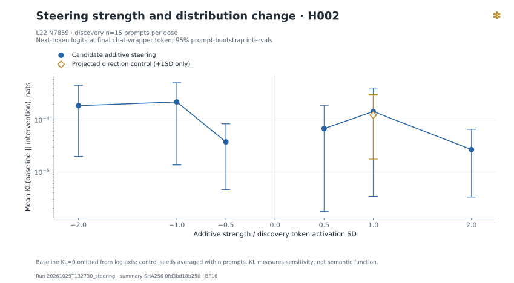

# 초기 실험 보고서 — BF16 전 계층 계측과 첫 Steering

**Gemma 4 12B를 실제 BF16으로 로딩하고 48개 계층의 MLP 중간 좌표 737,280개를 계측했다.** Discovery 60개 prompt의 사용자 본문 1,022 tokens를 계층마다 관측했고, 네 가지 경쟁 가설을 동결했다. 주 후보 두 개의 첫 개입에서는 출력 확률분포가 작게 달라졌지만, 평가한 630개 조건–prompt 조합에서 첫 token의 argmax는 바뀌지 않았다. 고정한 소수 prompt의 greedy 생성도 같았다. **특정 의미 기능의 인과적 제어를 발견했다는 결론은 아직 없다.**

이 문서는 **CP4 초기 증거**를 보존한다. 범위는 2026-10-29 13:29:07 KST에 종료한 첫 steering까지다. 이후 validation/test 결과는 별도 보고서에서 다룬다.

## 1. 실제 모델과 계측 검증

| 항목 | 실제 확인값 |
|---|---|
| 모델 | `google/gemma-4-12B-it` |
| 고정 revision | `707f0a3b8a3c7ad586ed01e27eafbad8a27dd0f7` |
| 실행 클래스 | `Gemma4UnifiedForConditionalGeneration` |
| 실제 계층 / 계층별 intermediate width | 48 / 15,360 |
| 전체 MLP 중간 좌표 | 737,280 |
| Parameter 수 / dtype | 11,959,730,176 / 전부 `torch.bfloat16` |
| 실행 | 단일 GPU, native HF eager attention, text-only, greedy generation |
| Smoke | 3 prompts, 28/28 checks PASS |

뉴런은 `model.language_model.layers.L.mlp.down_proj` **입력의 마지막 축 좌표**다. 즉 `GELU_tanh(gate(h)) × up(h)` 이후이며 SAE feature나 residual 좌표가 아니다. Smoke에서 전 계층 tensor shape·유한값, read-only logits의 exact equality, BF16 additive 수식, 개입 제거 후 복원, 반복 생성 일치와 zero→동일 baseline 좌표 복원을 확인했다. 최대 read-only logit 차이는 0이었다. [실제 로딩 기록](../logs/summary/model_load.json), [Smoke 기록](../logs/summary/smoke.json), [아키텍처 정의](../docs/ARCHITECTURE.md).

## 2. Discovery에서 관측한 범위

| 단계 | Prompt / 범주 | 사용자 tokens / 계층 | 계층 | 관측 좌표 |
|---|---:|---:|---:|---:|
| Selected-layer pilot | 15 / 15 | 275 | L0, L15, L31, L47 | 61,440 |
| Full-layer survey | 60 / 15 | 1,022 | 전체 48 | 737,280 |

Survey는 범주별 4개의 직접 작성한 무해한 discovery prompt다. 1,022는 **각 계층에서 같은 입력을 관측한 token 수**이며, 이를 48배의 독립 표본으로 세지 않는다. Chat wrapper와 생성 token은 활성 통계에서 제외했다. Token moments와 extrema는 선택된 전체 token에서 스트리밍 집계했고, quantile은 계층별 동일한 최대 64 token positions의 근사치다. 범주 평균·선택성은 각 prompt에 같은 무게를 주었다. [Pilot 원자료 요약](../logs/summary/pilot.json), [Survey 원자료 요약](../logs/summary/survey.json), [정의와 한계](../docs/METHODOLOGY.md).

60 prompts / 1,022 user tokens에서 계산한 neuron별 token 표준편차의 계층 내 분포다. 계층별 크기 차이를 인과적 중요도 차이로 해석하지 않는다.

## 3. 동결한 네 가지 가설

Discovery만 읽은 Codex 증거 검토로 13:24:32 KST에 동결했다. 외부 설명 API는 사용하지 않았다. 좌표와 설명은 모두 `candidate`이며, 표의 z는 검정통계량이나 신뢰도 확률이 아닌 discovery 분리도다.

| 가설 | 좌표 (0-based) | 관찰 기반 가설 | 경쟁 설명 | Discovery z |
|---|---|---|---|---:|
| H001 · primary | L15 N9637 | 번역 과제 문맥 반응 | 번역 동사·언어 이름, 외국어 문자·길이 | 3.992 |
| H002 · primary | L22 N7859 | 정보가 부족해 답을 결정하기 어려운 문맥 반응 | `uncertain/know` 어휘, 질문·부정문 형태 | 3.798 |
| H003 · expanded | L26 N719 | 더 깊은 계층의 번역 문맥 반응 | 언어 이름 자체, 번역 요청 어휘·구문 | 3.973 |
| H004 · expanded | L35 N990 | 프로그래밍 과제 반응 | `Python` 특정 어휘·동물 이름, 코드 표면 형태 | 3.628 |

H001의 상위 사례에는 번역 지시의 한국어 token과 언어명이, H004에는 `Python` token이 나타났다. 이는 의미 가설뿐 아니라 **표면 어휘 가설을 검사해야 하는 이유**다. 이번 737,280좌표 탐색의 최고 점수를 유의성으로 선언하지 않는다. [동결 가설과 상·하위 문맥](../configs/hypotheses.json).

가설 파일 SHA256: `62dd2149c2c1f9f2825e945add634da9a244f6a23dda8d561e81f28f35c413d3`.

## 4. 첫 Steering: 확률분포 변화와 제한된 생성 무변화

H001·H002에 discovery의 범주별 첫 prompt 하나씩, 총 **15 prompts**를 사용했다. 후보당 baseline, ±0.5/±1/±2 SD, zero ablation, restoration 및 4종 random controls × 3 seeds를 평가했다. 총 630개 조건–prompt 조합에는 baseline과 반복 대조군도 포함된다. 독립 prompt 수는 15이며 630이 아니다.

다음 표는 baseline 대비 next-token `KL(P_baseline || P_changed)`의 평균과 95% percentile bootstrap CI다. 단위는 nats다. 각 후보·조건의 n=15 prompts이며, random controls는 seed 11/29/47을 **prompt 안에서 먼저 평균**한 뒤 2,000회 prompt bootstrap을 적용했다. Random 조건당 실행 row는 45개다. [Steering 요약과 전체 메트릭](../logs/summary/steering.json).

| 후보 | 조건 | 평균 KL | 95% CI | 독립 prompt n |
|---|---|---:|---|---:|
| H001 | −1 SD | 2.8024e−4 | [1.7497e−5, 6.5079e−4] | 15 |
| H001 | +1 SD | 1.8743e−4 | [1.2933e−5, 4.6780e−4] | 15 |
| H001 | Zero ablation | 1.9949e−4 | [2.5708e−6, 4.9410e−4] | 15 |
| H001 | Random neuron · activation norm | 1.2261e−4 | [2.2829e−5, 2.4636e−4] | 15 |
| H001 | Random neuron · projected norm | 2.1498e−4 | [2.2593e−5, 5.0955e−4] | 15 |
| H001 | Random direction · activation norm | 1.8607e−4 | [2.1846e−5, 3.9733e−4] | 15 |
| H001 | Random direction · projected norm | 9.6353e−5 | [2.3417e−5, 1.9984e−4] | 15 |
| H002 | −1 SD | 2.2197e−4 | [1.3700e−5, 5.1699e−4] | 15 |
| H002 | +1 SD | 1.4524e−4 | [3.4284e−6, 4.1060e−4] | 15 |
| H002 | Zero ablation | 2.8635e−4 | [8.0063e−6, 6.5265e−4] | 15 |
| H002 | Random neuron · activation norm | 1.5724e−4 | [3.0101e−5, 3.5143e−4] | 15 |
| H002 | Random neuron · projected norm | 1.0749e−4 | [2.6987e−5, 2.1429e−4] | 15 |
| H002 | Random direction · activation norm | 1.8964e−4 | [2.6446e−5, 4.6824e−4] | 15 |
| H002 | Random direction · projected norm | 1.2435e−4 | [1.7768e−5, 3.0619e−4] | 15 |

개입이 분포를 바꿨다는 사실과 범주에 선택적으로 작용한다는 주장은 구별한다. 이 표는 대상과 대조군 차이의 paired CI나 의미 행동 평가가 아니므로, 평균 크기만으로 특정 기능을 판정하지 않는다.

두 그래프는 후보별 동일 15 prompts의 실제 dose sweep이다. KL이 강도에 따라 단조롭게 증가한다는 결론도 이 소규모 결과에서 확정하지 않는다.

### 개입 위치와 norm의 의미

- 관찰 통계는 **사용자 본문 평균**이지만 next-token 개입은 **마지막 chat-template wrapper token**에 적용했다. 생성에서는 매 forward의 마지막 token에 적용했다.
- SD는 discovery 본문 token 활성의 표준편차다. H001은 2.99694, H002는 0.314391이었다. Wrapper 위치의 자연 변동으로 다시 표준화한 강도가 아니다.
- Random controls의 명목상 norm은 **|dose|=1 SD에서만** 맞췄다. ±0.5/±2 SD 효과를 1 SD 대조군과 직접 비교해 선택성을 주장하지 않는다.
- Activation norm과 raw down-projection norm은 별도 조건이다. BF16 반올림 후 실제 norm도 측정했다. +1 SD의 평균 projected norm은 H001 6.29691, H002 0.546645였고, projected random-neuron 대조군은 각각 6.30029, 0.547262였다.
- `down_proj` 뒤 RMSNorm과 residual scaling이 있으므로 projected norm 일치가 최종 residual perturbation norm 일치를 뜻하지 않는다.

### 첫 token과 greedy 생성

모든 630개 조건–prompt 조합에서 첫 token argmax 변화가 0이었다. 생성은 일반 지식·무관 대조·번역·프로그래밍·불확실성의 **고정 5개 prompt**에서 조건당 최대 24 tokens로 제한했다. ±1/±2 SD, zero, seed 11의 projected random controls에서 baseline과 token ID sequence가 같았다. 두 후보를 합치면 비-baseline 생성 70개 비교에서 변화 0이지만, 같은 5개 prompt를 여러 조건에 재사용했으므로 독립 n=70으로 해석하지 않는다. Restoration 생성은 평가하지 않았다.

빈 출력·반복 trigram 기반 collapse proxy도 해당 생성들에서 0이었다. 이는 의미 정확도나 일반 성능 보존을 검증한 수치가 아니다. 짧은 greedy 출력이 같아도 확률분포·더 긴 생성·다른 입력에서 효과가 없다는 뜻은 아니다.

### 기술적 restoration

각 후보·prompt의 같은 forward에서 target 좌표를 zero로 만든 뒤, 같은 입력에서 얻은 clean 좌표를 다시 주입했다. **30/30 조합에서 baseline logits가 정확히 복원**됐고 KL과 clean 대비 perturbation norm은 0이었다. 이는 hook 정렬·제거·좌표 재주입의 기술 검증이며, 의미 행동의 causal mediation을 입증한 결과가 아니다.

## 5. 실행 기록과 재현 근거

| 단계 | Run ID | 시작 KST | 시간 | Peak reserved GPU |
|---|---|---|---:|---:|
| Pilot | `20261029T131907_pilot` | 13:19:07 | 2.25 s | 24.019 GB |
| Survey | `20261029T132008_survey` | 13:20:08 | 17.27 s | 24.394 GB |
| 보강 Smoke | `20261029T132723_smoke` | 13:27:23 | 6.82 s | 23.985 GB |
| 첫 Steering | `20261029T132730_steering` | 13:27:30 | 97.03 s | 24.495 GB |

실행일은 모두 2026-10-29다. GPU는 NVIDIA RTX PRO 6000 Blackwell Max-Q Workstation Edition 한 대다. GB는 10^9 bytes이며 steering peak reserved는 약 22.81 GiB다. Python 3.12.3, PyTorch 2.15.0/CUDA build 13.2, Transformers 5.21.0으로 실행했다. 위 stage elapsed 합은 123.37초이며 가중치 다운로드·설치·모델 로딩·개발 시간은 포함하지 않는다. GPU 사용률을 적분한 계산 시간도 아니다.

모델 로딩 자체는 6.49초, 로딩 후 allocated memory는 23.919 GB였다. 설정·소스 SHA256과 라이브러리 버전은 각 Run metadata에 보존했다. Corpus SHA256은 `88c8268a0b6b817b8f03f40b4db22cc81462d68b0e29f1ab2a1e0398c5ec6d53`이다. [실행 설정](../configs/model.yaml), [Steering 설정](../configs/steering.yaml), [방법론](../docs/METHODOLOGY.md), [연구 로그](../docs/RESEARCH_LOG.md), [공개 체크포인트](../logs/summary/publication.json)에서 재현 조건과 게시 상태를 확인할 수 있다.

## 6. 남은 검증과 연구 방향

| 항목 | 이 초기 보고서 범위의 상태 |
|---|---|
| BF16 계측·smoke·discovery·첫 steering 실행 | PASS |
| 네 가설의 독립 validation | NOT_EVALUATED |
| 동결 test의 반복 확인 | NOT_EVALUATED |
| 어휘·문자·길이·구문을 분리하는 반례 평가 | NOT_EVALUATED |
| 의미 기능의 선택적 인과 효과 | NOT_EVALUATED |
| 일반 성능·정확도 보존 | NOT_EVALUATED |

다음 검증은 동결 가설의 target-vs-rest activation AUC, 표면 어휘와 의미를 분리하는 양성·음성·near-miss·paraphrase·OOD 사례, +1 SD에서 projected control 대비 범주별 paired 분포 효과다. 가설별 양성 표본이 적고 discovery의 수십만 좌표 선택 편향이 있으므로 별도 validation/test와 사전 정의한 다중비교 정책을 유지해야 한다. 의미적 행동 지표가 없는 상태에서 `causally_supported`나 `replicated` 기능 라벨을 부여하지 않는다.

참조한 Lyra의 steering-first 설계, Apple의 단일 좌표 계측·평가 분리, Delphi의 설명과 반증 분리, interp-engine·NNsight·TransformerLens의 hook/backend 설계는 [참조 감사](../docs/REFERENCE_AUDIT.md)에 고정 revision·라이선스·실제 확인 경로와 함께 정리했다. 이 프로젝트들을 이번 환경에서 실행하거나 upstream 수치를 자체 결과로 사용하지 않았다. 초기 측정은 후속 원인 분리를 위한 증거이며 논문 수준의 새로운 의미 메커니즘 발견으로 제시하지 않는다.

원본 측정 스냅샷: [CP4 커밋](https://github.com/PigeonLabs/Gemma4_neuron_LAB/tree/df4c2c35b0ddc4933af87f6a8087b03a658b56a0). 초기 보고서의 시간·자원 수치는 해당 Run 기준이며, 현재 summary 포인터는 후속 재검증을 반영할 수 있습니다.
