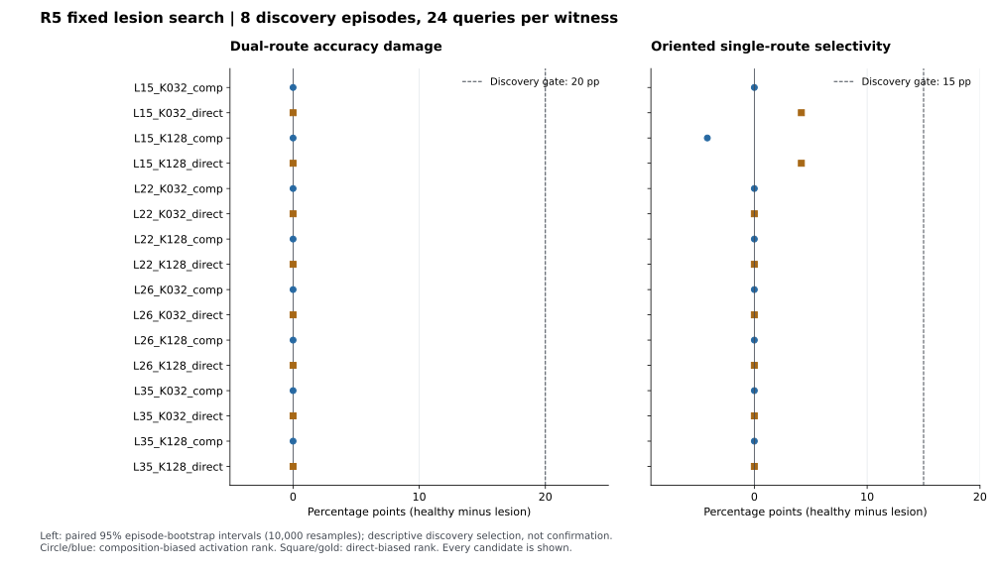

# R5 실측 결과 — 지속 차단 아래 피드백에 따른 경로 모집

**등록한 차단 자격 gate에서 중단했다. 이 조건의 모집 명제는 NOT_IDENTIFIABLE이며, 회복·모집은 미측정이다.**

GPT Pro Deep Research·Claude Opus 5.5 Extra Research와 검토한 2번 주제의 실제 12B 실험이다. 연구 명제는 **같은 1차 차단에서 오류 이력만 바꾸어도 새 질의의 인과적 계산 의존성이 달라지는가**다. 이번 결과는 그 명제를 검정할 수 있는 차단 쌍을 먼저 찾은 단계의 결과다.

판정: **STOPPED_AT_DISCOVERY_LESION_GATE**. 평가한 후보 **16개**, 적격 쌍 **0개**.

## 실제 실행과 기술 검증

- Run: `20261029T234656_round5_discovery`. 모델 `google/gemma-4-12B-it`, revision `707f0a3b8a3c7ad586ed01e27eafbad8a27dd0f7`.
- 실제 전체 forward **1,680회** = 기술 검증 **48회** + scientific 관측 **1,632행**. 한 관측마다 캐시 없이 전체 문맥을 다시 계산했다.
- 측정 시간 **380.83초**, peak allocated **48.23GB**, peak reserved **49.58GB**. GPU GB는 10진 단위다. 모델 로딩 시간은 별도 model-load JSON에 있다.
- 첫 50회 완료까지 **17.53초**. BF16/FP32 기술 검증과 서로 다른 입력 길이를 포함하므로 동일 길이 scientific 처리율로 해석하지 않는다.
- 실제 BF16·전체 FP32 upcast에서 읽기 전용/identity 훅, 모든 토큰 zero, query-only zero와 prefix 보존, 같은 모듈의 동시 차단, 동일 forward 복원, 훅 제거, tied-head/softcap 재생이 통과했다.
- 측정 seed `51029`, corpus seed `202610295501`. 입력 manifest SHA256 `4c336ce71f9134021e755f590d851e9c4ea5e8d90fbc5f3fdc0d378df08a251c`.
- 독립 discovery **8 episode**, episode당 고정된 질의 3개×4 witness. Calibration 16 / confirmation 48 episode의 모델 출력은 열지 않았다.
- 추론 전 공개 등록: [`33715757411b`](https://github.com/PigeonLabs/Gemma4_neuron_LAB/commit/33715757411b706c99c44e8fd078c161f0b2be0d). 11개 허용 파일의 원격 내용 해시를 다시 조회했다.

## Healthy 과제 준비

| 제공 정보 | 제한된 A/B/C/D 정확도 | 전체 어휘 top1 정답 코드 정확도 |
|---|---:|---:|
| 직접 표 | 100.00% | 100.00% |
| 두 단계 표 | 87.50% | 87.50% |
| 양쪽 표 | 100.00% | 100.00% |
| 코드 변환만 | 100.00% | 100.00% |

각 witness는 24개 질의이나 독립 통계 단위는 8개 episode다. 주 readout은 네 코드만의 argmax다. 전체 어휘에서의 top1을 별도로 제시했으며, 자유 생성의 일반적인 품질 회복을 측정하지 않았다.

## 고정한 차단 후보의 결과

층 15/22/26/35×크기 32/128×활성 대비 두 방향의 16개 native 집합이다. 후보는 건강한 discovery 단일 경로 witness에서 query 구간 평균 절대 활성값의 정규화된 대비로만 선정했다. 차단은 MLP.down_proj 입력 좌표를 모든 토큰에서 0으로 만든다. 상대 활성 대비가 손상 또는 의미 기능을 보장하지 않는다.

손상은 healthy−차단 정확도다. 양수는 악화, 음수는 개선이다. 아래 퍼센트포인트(pp)와 CI는 선택에 사용한 discovery의 기술 통계이며 확증 CI가 아니다. Episode 안의 질의를 먼저 평균한 뒤 8 episode를 10000회 재표집했다.

| 후보 | 양쪽 표 손상 pp [95% CI] | 직접 표 손상 pp | 두 단계 손상 pp | 코드 변환 손상 pp | 방향별 경로 특이성 pp | 적격 |
|---|---:|---:|---:|---:|---:|---|
| L15_K032_composition | 0.00 [0.00, 0.00] | 0.00 | 0.00 | 0.00 | 0.00 | 실패 |
| L15_K032_direct | 0.00 [0.00, 0.00] | 0.00 | -4.17 | 0.00 | 4.17 | 실패 |
| L15_K128_composition | 0.00 [0.00, 0.00] | 0.00 | -4.17 | 0.00 | -4.17 | 실패 |
| L15_K128_direct | 0.00 [0.00, 0.00] | 0.00 | -4.17 | 0.00 | 4.17 | 실패 |
| L22_K032_composition | 0.00 [0.00, 0.00] | 0.00 | 0.00 | 0.00 | 0.00 | 실패 |
| L22_K032_direct | 0.00 [0.00, 0.00] | 0.00 | 0.00 | 0.00 | 0.00 | 실패 |
| L22_K128_composition | 0.00 [0.00, 0.00] | 0.00 | 0.00 | 0.00 | 0.00 | 실패 |
| L22_K128_direct | 0.00 [0.00, 0.00] | 0.00 | 0.00 | 0.00 | 0.00 | 실패 |
| L26_K032_composition | 0.00 [0.00, 0.00] | 0.00 | 0.00 | 0.00 | 0.00 | 실패 |
| L26_K032_direct | 0.00 [0.00, 0.00] | 0.00 | 0.00 | 0.00 | 0.00 | 실패 |
| L26_K128_composition | 0.00 [0.00, 0.00] | 0.00 | 0.00 | 0.00 | 0.00 | 실패 |
| L26_K128_direct | 0.00 [0.00, 0.00] | 0.00 | 0.00 | 0.00 | 0.00 | 실패 |
| L35_K032_composition | 0.00 [0.00, 0.00] | 0.00 | 0.00 | 0.00 | 0.00 | 실패 |
| L35_K032_direct | 0.00 [0.00, 0.00] | 0.00 | 0.00 | 0.00 | 0.00 | 실패 |
| L35_K128_composition | 0.00 [0.00, 0.00] | 0.00 | 0.00 | 0.00 | 0.00 | 실패 |
| L35_K128_direct | 0.00 [0.00, 0.00] | 0.00 | 0.00 | 0.00 | 0.00 | 실패 |

자격은 각각 dual 손상≥20pp, 반대 단일 경로 손상 차≥15pp, 코드 변환 손상≤5pp, 두 집합의 dual 손상 차≤10pp, disjoint 좌표, discovery-fixed 오류 특징 AUC≥.70이다. 점추정 자격을 통과하더라도 독립 calibration에서 손상 CI 하한>10pp 및 고정 오류 프로파일의 일반화를 다시 검증해야 한다.

## 해석

16개 차단 모두 양쪽 표 조건에서 healthy와 같은 24/24 정답을 유지해, 관측 정확도 손상이 0pp였다. 이 8 episode를 재표집한 [0,0] 구간은 모집단의 손상이 정확히 0이라는 동등성 증명이 아니다.

등록한 bounded search에서, 회복을 검정할 만큼 손상되고 두 경로에 대해 반대 특이성을 갖는 두 차단을 확보하지 못했다. 따라서 **이 과제·후보 선정법·층·크기의 조합으로는 모집 명제를 식별할 수 없다**. 차단을 실제로 전달하지 못한 기술 실패와는 구별한다.

이 결과는 모델이 차단 아래 적응할 수 없다는 증거도, 기능적 경로가 존재하지 않는다는 증거도 아니다. 건강한 동작의 활성 대비로 후보를 찾는 방식과 이번 차단 범위가 필요한 손상을 만들지 못했다는 한계에 해당한다. 손상 자격이 없으므로 회복률이나 모집 효과를 계산하지 않았으며, dose·층·후보·과제·임계값을 사후에 바꾸지 않았다.

다음 연구가 필요하다면, 먼저 discovery에서 **양쪽 경로의 실제 인과적 병목을 찾아 두 손상 프로파일을 만들 수 있는가**를 별도 연구로 검증해야 한다. 이 진단 결과를 R5 모집 가설의 지지로 합치지 않는다.

## 남은 명제의 상태

| 항목 | 상태 |
|---|---|
| 실제 12B 기술/훅 검증 | PASS |
| 제한된 차단 자격 탐색 | STOPPED_AT_DISCOVERY_LESION_GATE |
| 독립 calibration / confirmation | NOT_EVALUATED |
| 오류 이력에 따른 정답률 회복 | NOT_EVALUATED |
| Query-time 모집 및 norm replay | NOT_EVALUATED |
| 보편적인 적응 불가능성 | 검정하지 않음 |

CPU 재생은 raw **1,632행**의 정답·코드·margin·호출 수·native 후보 순위·선택 gate를 확인했다. 이전 연구 파일 **38개**의 해시가 유지되었다. CPU 재생과 합성 단위 테스트는 실제 모델의 독립 복제가 아니다.

[실측 JSON](../logs/summary/round5_discovery.json) · [CPU 재생](../logs/summary/round5_replay.json) · [기술 검증](../logs/summary/round5_technical.json) · [사전 등록](ROUND5_EXECUTION_REGISTRATION_KO.md) · [협업 설계](ROUND5_DESIGN_KO.md)
