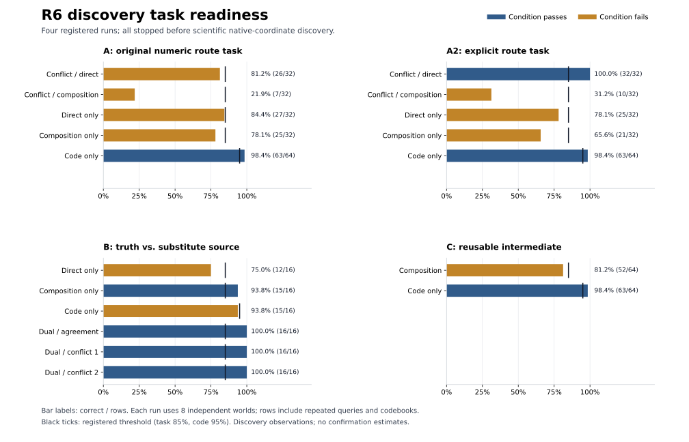

<!-- Generated by scripts/build_round6_execution_report.py from verified measurement JSON. -->
# R6 세 실험 실제 실행 결과

세 실험 A·B·C를 실제 Gemma 4 12B에서 실행했고, 원래 A 실패 뒤 별도 등록한 A2도 1회 실행했다. **모든 실행은 사전 과제 준비도 기준에서 중단되었다. 인과적 병목·백업·중간값 재사용 명제는 판정할 수 없다.**

총 **744회** 실제 forward 중 과제 측정은 **608회**, BF16/FP32 기술 검증은 **136회**다. 기술 검증은 네 실행 모두 통과했다. 조건부 native 후보 탐색·calibration·confirmation은 `NOT_EVALUATED`이며 확증 모델 호출은 0회다.

| 실행 | 핵심 준비도 결과 | 종료 |
|---|---|---|
| A: 원래 숫자 선택자 과제 | Conflict / direct 26/32 (81.25%); Conflict / composition 7/32 (21.88%); Direct only 27/32 (84.38%); Composition only 25/32 (78.12%); Code only 63/64 (98.44%) | `STOPPED_AT_TASK_READINESS` |
| A2: 명시적 경로 과제 | Conflict / direct 32/32 (100.00%); Conflict / composition 10/32 (31.25%); Direct only 25/32 (78.12%); Composition only 21/32 (65.62%); Code only 63/64 (98.44%) | `STOPPED_AT_TASK_READINESS` |
| B: 손상 후 진실·출처 백업 | Direct only 12/16 (75.00%); Composition only 15/16 (93.75%); Code only 15/16 (93.75%); Dual / agreement 16/16 (100.00%); Dual / conflict 1 16/16 (100.00%); Dual / conflict 2 16/16 (100.00%) | `STOPPED_AT_TASK_READINESS` |
| C: 재사용 가능한 중간값 | Composition 52/64 (81.25%); Code only 63/64 (98.44%) | `STOPPED_AT_TASK_READINESS` |

각 과제 조건은 정확도 85% 이상, 코드 변환은 95% 이상이어야 한다. 각 실행의 준비도 자료는 **8개의 독립 nonce 세계**에서 나온 반복 질의·코드북 변형을 포함한다. 표의 행 수를 독립 표본 수로 해석하지 않는다. 서로 다른 과제·세계이므로 A와 A2의 차이를 과제 변경의 인과적 효과로 추정하지 않는다.

## 무엇을 알게 되었는가

A2에서는 두 표 경로가 충돌할 때 직접 경로를 따르는 비율이 100%였지만 합성을 지시하면 31.25%였다. B에서는 두 경로를 함께 제시한 세 맥락 모두 100%였지만 직접 표만 남기면 75%였고, 코드 변환도 93.75%였다. C에서는 직접 지름길이 없는 합성 과제 정확도가 81.25%였다. 이 결과는 현재 nonce 표 과제와 지시 형식에서 필요한 기본 행동이 조건에 따라 불안정하다는 관측이다.

따라서 손상 후 변화가 특정 계산 경로의 인과적 기여를 나타내는지, 원래 과제를 수행하지 못한 상태의 변동인지 분리할 전제가 성립하지 않았다. **병목이 없다거나 모델이 중간값을 사용하지 않는다는 결론은 지지하지 않는다.** 직접 경로 단독 조건의 실패를 직접 경로 기능의 부재로 해석하지도 않는다.

정확도는 A/B/C/D 네 코드 중 다음 토큰 logit 최댓값으로 정의했다. 모든 실제 full-vocabulary top1도 별도 점검했다. 미등록 출력 형식을 사후에 바꿔 정답을 구제하지 않았다. 구체적인 출력·입력은 로컬 원시 기록에만 둔다.

## 연구 변경과 분할

원래 A의 8행·숫자 선택자 과제가 준비도에서 실패한 뒤, 이를 보존하고 새 seed·세계·ID로 4행·명시적 경로 과제 A2를 별도 사전 등록했다. 데이터 관찰 후 설계가 바뀌었음을 명시하며 원래 연구의 단순 연장으로 취급하지 않는다. B/C는 첫 모델 출력 전에 동일한 4행 계열에서 독립 등록했다. 추가 과제 수정은 하지 않았다. [변경 사유와 범위](ROUND6_EXPLICIT_REVISION_KO.md).

발견용 세계에서만 준비도를 평가했다. 생성해 둔 calibration 16세계와 confirmation 64세계의 정답 oracle은 모델 실측 결과가 아니며, 두 분할의 모델 출력은 열지 않았다. 최초 실패 기준과 52,000회/4시간 상한을 유지했다.

## 재현·검산

모델: `google/gemma-4-12B-it` / revision `707f0a3b8a3c7ad586ed01e27eafbad8a27dd0f7`. BF16 훅 동등성, out-of-place 전달·제거, 동일 저장값의 FP32 상향 변환, tied-head/softcap 및 RMSNorm 기준 분모 재생을 기술 검증했다. 과학적 준비도 측정은 FP32에서 수행했다.

| 실행 | 측정 seed | corpus seed | 과학적/기술 호출 | 과학적 실행 시간 | GPU 예약 메모리 최댓값 |
|---|---:|---:|---:|---:|---:|
| A: 원래 숫자 선택자 과제 | 61030 | 202610306100 | 192/34 | 35.55s | 49.53 GB |
| A2: 명시적 경로 과제 | 62030 | 202680306100 | 192/34 | 26.85s | 49.77 GB |
| B: 손상 후 진실·출처 백업 | 62031 | 202680306100 | 96/34 | 15.92s | 49.54 GB |
| C: 재사용 가능한 중간값 | 62032 | 202680306100 | 128/34 | 17.82s | 49.41 GB |

각 run의 입력 분할·시간·장치·패키지 버전·dtype·코드 해시·모델 revision·CPU/GPU/디스크 자원 기록을 보존했다. 원시 608행의 정답을 별도 코드로 재계산하고 토큰 ID, 네 코드 argmax·log odds, softcap 수식, 호출 수, 등록 파일·이전 결과 해시를 전수 대조했다. 이 CPU 재검산은 새 모델 실험이나 추가 확증이 아니다. 단일 GPU에서 실행을 순차 처리했다.

[검증 결과 JSON](../logs/summary/round6_execution_replay.json) · [실행 집계 JSON](../logs/summary/round6_execution_results.json) · [실행 설정](../configs/round6_explicit_execution.yaml) · [B의 손상 검색 프로토콜](../configs/round6_B_discovery_protocol.yaml)

## 다음 판단

현재 우선순위는 native 뉴런 검색 확대보다 **안정적으로 수행하는 과제를 별도 발견 자료에서 확보하는 것**이다. nonce 명명, 표 직렬화, 지시 형식, 코드 변환을 분리해 어떤 변경이 실패와 관련되는지 먼저 측정해야 한다. 새 형식은 새로운 연구로 등록하고 독립 세계에서 준비도를 확인한 뒤 A·B·C의 인과 개입을 다시 검토한다. 이번 자료로 후보 뉴런이나 긍정 가설을 선택하지 않는다. 기존 신규성 평가는 여전히 `UNVERIFIED`다.
