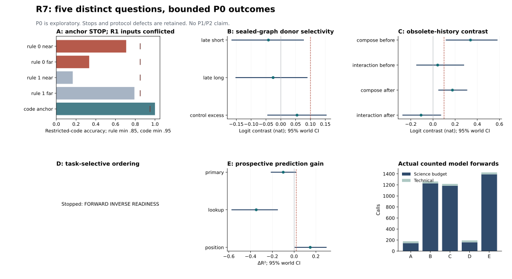

# R7 실제 P0 결과와 해석

독립 질문 다섯 개에 실제 **4278회** forward를 수행했다. Science budget 4108회에는 보정·과제 준비도·B 봉인 instrument가 포함되며, 별도 BF16/FP32 기술 검사 170회다. P1/P2는 NOT_EVALUATED다.

원본 BF16 파라미터 값을 FP32로 상향한 동일값 비교이며 FP32를 정답 모델로 간주하지 않는다. 모델 revision은 `707f0a3b8a3c7ad586ed01e27eafbad8a27dd0f7`이다. 한 번에 GPU 프로세스 하나만 실행했다.

| 후보 | 실제 science / technical | 분류 | 등록 gate |
|---|---:|---|---|
| A | 144 / 34 | Inconclusive | STOPPED_AT_RULE_OR_CODE_ANCHOR |
| B | 1228 / 34 | Negative | P0_COMPLETED |
| C | 1184 / 34 | Negative | P0_COMPLETED |
| D | 160 / 34 | Inconclusive | STOPPED_AT_FORWARD_INVERSE_READINESS |
| E | 1392 / 34 | Negative | P0_COMPLETED |

등록 준비도와 주효과는 A/B/C/D 중 argmax와 그 logit margin을 사용한다. 전체 vocabulary top-1은 별도로 보존했으며 자유 생성 평가를 수행하지 않았다. 이 구분 없이 모델의 전체 정확도나 의미 동작으로 일반화하지 않는다.

A의 48개 R1 anchor는 R0 새 예시와 충돌하는 설계 오류다. 해당 점수를 순수 규칙 실행 능력이나 논리 전파의 부재로 해석하지 않는다. 원본 입력과 중단 판정을 보존했다. 모순 없는 R0 near 17/24와 far 8/24도 기준 미만이지만 사후 제외·재실행을 하지 않았다.

## A — Inconclusive

준비도: rule_0_near 17/24 (70.8%), rule_0_far 8/24 (33.3%), rule_1_near 4/24 (16.7%), rule_1_far 19/24 (79.2%), code_anchor 48/48 (100.0%).

Run `20261030T033152_round7_A_P0`. science 경과 25.16초, peak GPU allocated 48.02 GB. 정확한 seed·환경·분할·해시·시간은 [집계 JSON](../logs/summary/round7_execution_results.json)에 있다.

## B — Negative

준비도: short 24/24 (100.0%), long 24/24 (100.0%), code 24/24 (100.0%).

| 등록 효과 | 평균 [95% 세계 bootstrap CI] |
|---|---|
| late_short | -0.041636 [-0.16467, 0.076252] |
| late_long | -0.02595 [-0.15125, 0.088442] |
| early_short | 0.023005 [-0.059849, 0.11039] |
| early_long | -0.039322 [-0.35051, 0.26418] |
| control_excess | 0.054754 [-0.043875, 0.15283] |

Run `20261030T034542_round7_B_P0`. science 경과 612.84초, peak GPU allocated 48.34 GB. 정확한 seed·환경·분할·해시·시간은 [집계 JSON](../logs/summary/round7_execution_results.json)에 있다.

## C — Negative

준비도: direct 62/64 (96.9%), compose 61/64 (95.3%), code 32/32 (100.0%).

| 등록 효과 | 평균 [95% 세계 bootstrap CI] |
|---|---|
| direct_before | 0.29654 [0.073276, 0.51431] |
| direct_after | 0.28325 [0.14367, 0.40197] |
| compose_before | 0.33878 [0.1195, 0.57846] |
| compose_after | 0.17572 [0.052327, 0.30512] |
| interaction_before | 0.042239 [-0.14653, 0.27672] |
| interaction_after | -0.10753 [-0.27178, 0.069341] |

Run `20261030T035615_round7_C_P0`. science 경과 212.68초, peak GPU allocated 48.01 GB. 정확한 seed·환경·분할·해시·시간은 [집계 JSON](../logs/summary/round7_execution_results.json)에 있다.

## D — Inconclusive

준비도: forward 57/64 (89.1%), inverse 32/64 (50.0%), code 32/32 (100.0%).

Run `20261030T040004_round7_D_P0`. science 경과 21.57초, peak GPU allocated 48.00 GB. 정확한 seed·환경·분할·해시·시간은 [집계 JSON](../logs/summary/round7_execution_results.json)에 있다.

## E — Negative

준비도: lookup 40/40 (100.0%), position 40/40 (100.0%), code 40/40 (100.0%).

| 등록 효과 | 평균 [95% 세계 bootstrap CI] |
|---|---|
| primary | -0.099841 [-0.21011, 0.014959] |
| lookup | -0.34791 [-0.57121, -0.15341] |
| position | 0.14823 [0.0095364, 0.29436] |

보정의 평균 절대 margin 변화(nat): native_mlp=0.0663566, native_attn=0.0600318, resid=0.221315. 고정 dose를 변경하지 않았다.

Run `20261030T040041_round7_E_P0`. science 경과 162.90초, peak GPU allocated 47.99 GB. 정확한 seed·환경·분할·해시·시간은 [집계 JSON](../logs/summary/round7_execution_results.json)에 있다.

## B의 실제 답 변화: 사후 기술 통계

등록된 logit 성공 기준과 행동 전달을 구별하기 위한 기술 집계다. 아래 쌍들은 독립 세계 안의 반복 질의이며 추가 성공 gate로 사용하지 않았다.

| 질의 공개 / 간격 | query 행 | seal 원답 정확 | same-key donor 답(full vocab) | other-key 원답 보존(full vocab) |
|---|---:|---:|---:|---:|
| late / short | 24 | 7 | 0 | 0 |
| late / long | 24 | 7 | 0 | 2 |
| early / short | 24 | 7 | 0 | 0 |
| early / long | 24 | 7 | 0 | 3 |

B는 47개 층의 token 궤적을 반복 교환하며 carrier의 원문 접근 자체는 계속 허용한다. 따라서 단일 상태의 저장 용량, 원문 재열람 없이 유지되는 기억, 자연 모델에서의 필요성을 입증한 것이 아니다. null graph equality는 우회 봉인의 기술 증거이고 자연 저장 메커니즘의 증거가 아니다.

C의 효과는 일치하는 최종 상태에서의 이력 treatment다. 단순 갱신 실패는 [RippleEdits](https://arxiv.org/html/2307.12976v2), 업데이트 범위와 순서의 넓은 문제는 [DeReLab](https://aclanthology.org/2026.emnlp-main.1625/)와 겹친다. D의 순서 효과는 n-gram과 독립된 구조 원인이 아니며 [Invisible Reasoning](https://arxiv.org/html/2607.22925v1)의 일반 filler 효과를 새 발견으로 세지 않는다. E의 예측 전이는 [SPARK](https://arxiv.org/html/2607.10296v1)의 susceptibility와 비교해야 하고, 공통 head/readout 대안을 통과해도 공통 인과 기제를 바로 뜻하지 않는다.

## 검증 범위

원시 행의 oracle·응답 코드·logits/softcap·margin·토큰 직렬화·개입 scope·forward 수·등록 해시·기존 91개 파일과 세계 단위 통계를 CPU에서 독립 재계산했다. GPU 독립 반복은 수행하지 않았다. synthetic CPU 단위 테스트는 실제 12B 측정과 별개다.

[원시 집계 재검산](../logs/summary/round7_replay.json) · [입력 결함·동치 감사](../logs/summary/round7_input_audit.json) · [사전등록 공개](../logs/summary/round7_BCDE_preregistration_publication.json) · [후보와 선행 대비](ROUND7_CANDIDATES_KO.md)

실제 결과를 두 연구 채팅에 동일한 핵심 증거로 전달한 뒤 독립 검토와 적대적 교차검토를 수집해야 한다. 완료된 이후의 판단은 별도 공동 검토 기록으로 남기며, 현재 문서 자체는 외부 모델의 사후 동의를 뜻하지 않는다.
