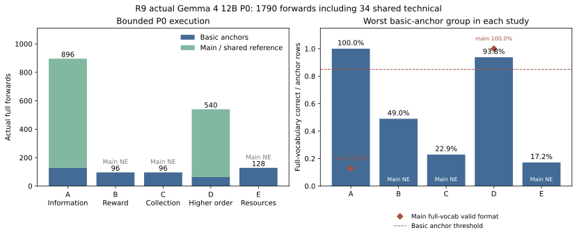
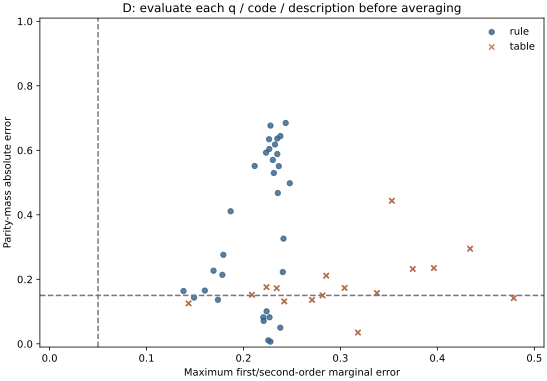

# R9 실제 P0 결과와 한계

새 다섯 연구의 실제 모델 호출은 **1790회**다. 과학 1756회와 공유 기술 34회를 구별한다. 논문 Go는 아직0개며 P1/P2는 NOT_EVALUATED다.

실행 전 [사전등록](ROUND9_P0_PREREG_KO.md)을 공개했고, 모든 과학 소스·입력·gates는 동결했다. 최초 공개 커밋은0a1d8ab3a4992435e6b6b572a2c9531061d66b93이다. [정확 결과 JSON](../logs/summary/round9_execution_results.json), [원시 행 재검산](../logs/summary/round9_P0_replay.json)을 참조한다.

| 질문 | 과학 호출 | anchor/main | gate | 등록 분류 |
|---|---:|---:|---|---|
| A 같은 정보량에서 행동에 필요한 구분을 놓치는가? | 896 | 128/768 | STOPPED_AT_FULL_VOCABULARY_FORMAT | Inconclusive |
| B 경로합을 보존해도 보상의 논리적 위치가 선택을 바꾸는가? | 96 | 96/0 | STOPPED_AT_BASIC_ANCHORS | Inconclusive |
| C 무관한 수집 절차와 우도를 바꾸는 선별을 구별하는가? | 96 | 96/0 | STOPPED_AT_BASIC_ANCHORS | Inconclusive |
| D 저차 통계가 맞아도 고차 결합만 실패하는가? | 540 | 64/476 | P0_MEASURED | Negative |
| E 개별 자원 가능성을 전역 실행 가능성으로 합치는가? | 128 | 128/0 | STOPPED_AT_BASIC_ANCHORS | Inconclusive |

## 등록한 대비

행동 대비의 추정 대상은 서로 다르다. CI는 세계 단위 탐색적 bootstrap이며 모집단 동등성·다중 후보의 확증 검정이 아니다. 형식이 무너진 A의 산술상0을 무효과 추정으로 그리지 않는다.

### A. 같은 정보량에서 행동에 필요한 구분을 놓치는가?

등록 분류 **Inconclusive**, gate `STOPPED_AT_FULL_VOCABULARY_FORMAT`.

전체 어휘에서 지정 코드를 고른 main은 99/768 (12.89%)다. 첫 토큰 빈도: {'To': 669, 'A': 78, 'B': 21}.
무효 형식 행을 YES=0으로 코딩한 보조 산술값은 과학적 무효과 추정이 아니다. 주 대비는 NOT_IDENTIFIABLE이며 제한 점수나 형식 조건부 선별로 구제하지 않는다.

### B. 경로합을 보존해도 보상의 논리적 위치가 선택을 바꾸는가?

등록 분류 **Inconclusive**, gate `STOPPED_AT_BASIC_ANCHORS`.

- path_sum: 47/96 = 48.96%.

cue의 경로 선택 지시와 anchor의 YES/NO 질문이 충돌할 가능성이 있다. 이 결과로 합산 능력 부재를 단정하지 않는다.

main 미측정이다. 실패한 준비도를 회복하기 위한 prompt나 조건 수정은 하지 않았다.

### C. 무관한 수집 절차와 우도를 바꾸는 선별을 구별하는가?

등록 분류 **Inconclusive**, gate `STOPPED_AT_BASIC_ANCHORS`.

- Bayes_weights: 22/96 = 22.92%.

형식을 지킨 첫 토큰은48/96이다. 기본 계산 gate에는 형식 실패와 유효 코드의 오답이 함께 들어 있으므로 확률 추론 능력을 분리해 평가하지 못했다.

main 미측정이다. 실패한 준비도를 회복하기 위한 prompt나 조건 수정은 하지 않았다.

### D. 저차 통계가 맞아도 고차 결합만 실패하는가?

등록 분류 **Negative**, gate `P0_MEASURED`.

모든 코드·설명을 통과한 선택적 고차 오류 family: 0/8.

각 q·코드·설명에서 먼저 계산한 분포다. 이진 문법 decoder의 정확한 분포이며 자유 생성 분포나 내부 난수 능력을 측정한 것이 아니다.

rule: 저차 최대오차 범위 0.1382–0.2478; 저차 기준 통과 0/32조건. weighted valid mass 최솟값 0.999938.

table: 저차 최대오차 범위 0.1434–0.4788; 저차 기준 통과 0/32조건. weighted valid mass 최솟값 0.999996.

Exact temperature1 restricted binary-grammar decoder distribution; no inference about free generation or internal randomness.
전체 어휘에서 유효 답변을 고른 비율: 100.00%. 제한 logit로 형식 실패를 구제하지 않는다.

### E. 개별 자원 가능성을 전역 실행 가능성으로 합치는가?

등록 분류 **Inconclusive**, gate `STOPPED_AT_BASIC_ANCHORS`.

- edge: 63/64 = 98.44%.
- union_count: 11/64 = 17.19%.

union-count의 유효 형식11/64개는 모두 정답이었다. 나머지53개는 형식 실패이므로 이 수치를 union 계산 능력17%로 해석하지 않는다.

main 미측정이다. 실패한 준비도를 회복하기 위한 prompt나 조건 수정은 하지 않았다.

## 재현·해석 범위

모델 google/gemma-4-12B-it, revision `707f0a3b8a3c7ad586ed01e27eafbad8a27dd0f7`. FP32는 같은 저장 BF16값의 upcast 계산 조건이며 참값 모델이 아니다. 공유 기술34회에서 두 dtype의 identity·복원·softcap·계측 검사가 통과했다. R1–R8 보호 파일139개와 등록 소스·입력이 일치했다.

각 run metadata에 환경·seed·dtype·장치·시간·메모리와 source hash를 보존했다. 원시 입력/행은 로컬 runs/에 있고 공개 JSON에 해시를 둔다. CPU replay는 기록된 top1/전체 어휘 질량의 사용·분류를 검산한다. 전체262144개 logits를 저장하지 않았으므로 이 숫자를 두 번째 GPU 평가로 재현했다고 하지는 않는다.

사후 설계 감사: B의 cue는 경로 선택을 지시하면서 anchor query는 합계의 YES/NO를 물었다. 이것은 명령 충돌 가능성이며 합산 능력 부재로 단정할 수 없다. C와 E의 anchor 실패에는 첫 답변 형식 실패가 포함된다. E의 union-count는 형식 유효11/64이며 그11개는 모두 정답이었다. 따라서 union-count 이해가17%라고 해석하지 않는다.

D의 전체 확률표에서 (q,code flip)과 (1−q,반대 flip)은 동일한 입력이 될 수 있다. 동일 family의 반복이고 새 표본이나 독립 codebook 증거가 아니다. shared uniform reference도 반복 입력을 포함한다. 등록 시 세계 안 반복을 허용한 input contract와 일치하며 실제 호출 수에서 제거하지 않는다.

이 보고서 시점에는 실측 후 외부 독립 비판과 적대적 교차검토가 아직 남아 있다. P0 분류와 논문 투자 판단은 다르다. 새 가설이나 P1을 진행하려면 사용하지 않은 분할과 고정된 예측·기여 판단이 필요하다.
